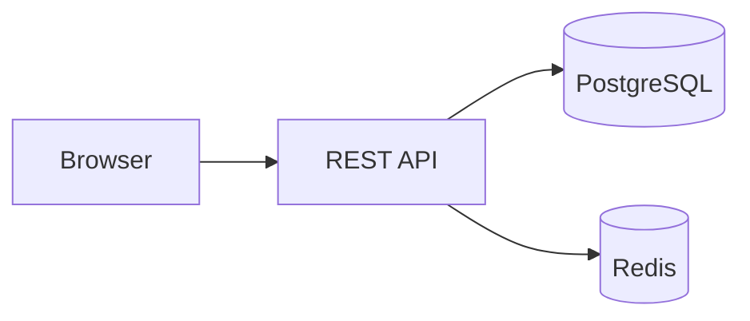
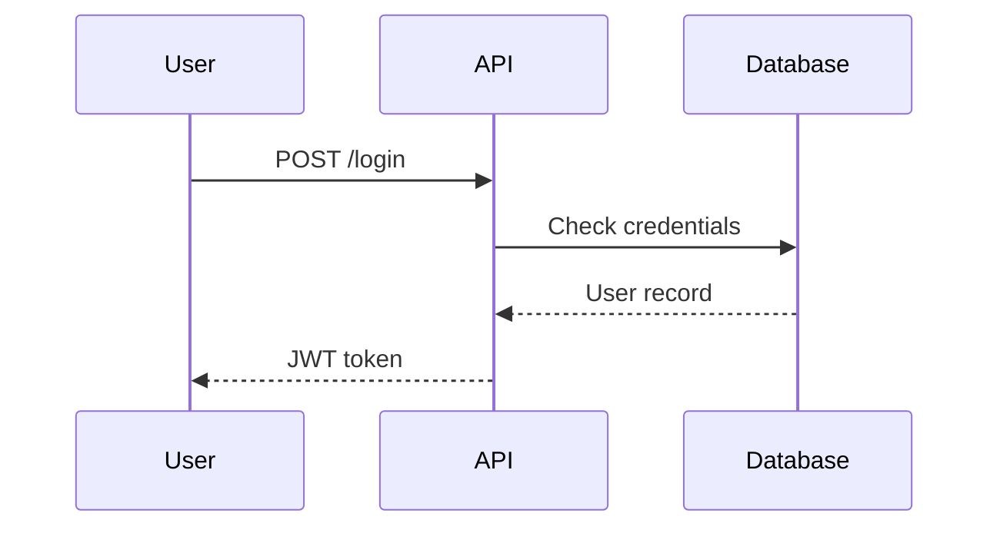
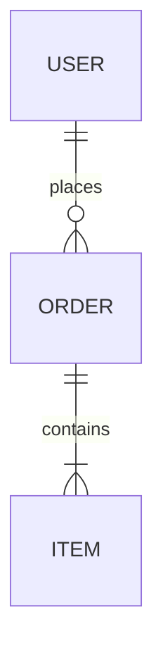

# Architecture Diagrams (Mermaid)

Use Mermaid: it renders natively on GitHub and GitLab.

## Choosing the diagram type

| Need | Mermaid type |
|---|---|
| Overview of components | `flowchart` |
| Interactions between services over time | `sequenceDiagram` |
| Data model | `erDiagram` |
| Object lifecycle | `stateDiagram-v2` |
| Class structure | `classDiagram` |

## Examples

### Architecture

### Sequence

### Data model

## Rules
- One diagram = one message. Maximum ~10 nodes, otherwise split it.
- Name nodes after the real code entities (services, modules).
- Always add one sentence of explanation before or after the diagram.
- Place diagrams in `docs/architecture.md` or inside the README.
- Wrap labels containing parentheses or special characters in quotes.